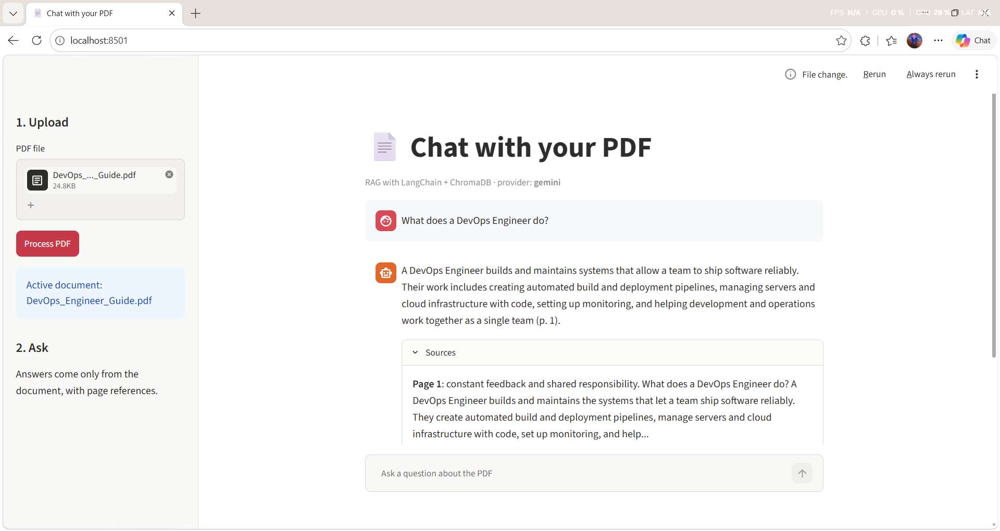

# Chat with your PDF (RAG)

Upload a PDF and ask questions about it. Answers are generated **only from the
document** and come with page references, so you can check every claim.

Built with **Python, LangChain, ChromaDB, Streamlit** and the **Gemini** (free tier)
or **OpenAI** API.



## How it works

```
PDF ──► split into chunks ──► embeddings ──► ChromaDB (saved on disk)
                                                  │
question ──► embed ──► find top-k similar chunks ─┘
                              │
                 prompt = "answer only from this context" + chunks
                              │
                            LLM ──► answer + page numbers
```

1. **Ingest** (`rag/ingest.py`): read the PDF page by page, split it into
   1000-character chunks with 200 overlap, embed them, store them in ChromaDB.
   The collection is named after the file hash, so uploading the same PDF again
   re-uses stored vectors and spends no embedding quota.
2. **Retrieve + answer** (`rag/qa.py`): embed the question, fetch the 4 most
   similar chunks, and ask the LLM to answer from them only. If the answer is not
   in the context, it says so instead of guessing.
3. **Providers** (`rag/providers.py`): switch between Gemini and OpenAI with one
   environment variable.

## Setup (Windows PowerShell)

```powershell
git clone <your-repo-url>
cd pdf-rag-qa
python -m venv .venv
.venv\Scripts\Activate.ps1
pip install -r requirements.txt
copy .env.example .env
```

Open `.env` and add your key. For Gemini, create a free key at
https://aistudio.google.com/apikey and set `GOOGLE_API_KEY=...`.
To use OpenAI instead, set `LLM_PROVIDER=openai` and `OPENAI_API_KEY=...`.

## Run

Web app:

```powershell
streamlit run app.py
```

Command line:

```powershell
python cli.py path\to\file.pdf
python cli.py path\to\file.pdf -q "What is the refund policy?"
```

## Tests

The tests use fake embeddings and a fake LLM, so they need no API key or internet.

```powershell
pip install -r requirements-dev.txt
python -m pytest
```

## Configuration

All optional, set in `.env`:

| Variable | Default | Meaning |
| --- | --- | --- |
| `LLM_PROVIDER` | `gemini` | `gemini` or `openai` |
| `GEMINI_CHAT_MODEL` | `gemini-2.5-flash` | Change if the API says the model is not found |
| `GEMINI_EMBEDDING_MODEL` | `models/gemini-embedding-001` | Embedding model |
| `CHUNK_SIZE` / `CHUNK_OVERLAP` | `1000` / `200` | Chunking |
| `TOP_K` | `4` | Chunks sent to the LLM per question |

## Limitations and ideas

- Scanned PDFs (images without text) need OCR first; the app shows a clear error.
- Each question is answered independently (no chat memory). Next step: rewrite
  follow-up questions using the chat history.
- Possible upgrades: multiple PDFs at once, hybrid (keyword + vector) search,
  re-ranking, and an evaluation set of question/answer pairs.

## Project structure

```
app.py            Streamlit UI
cli.py            Terminal chat
rag/config.py     Settings from environment variables
rag/providers.py  Gemini / OpenAI embeddings and chat models
rag/ingest.py     PDF -> chunks -> ChromaDB
rag/qa.py         Retrieval + prompt + answer with sources
tests/            Offline unit tests
```
